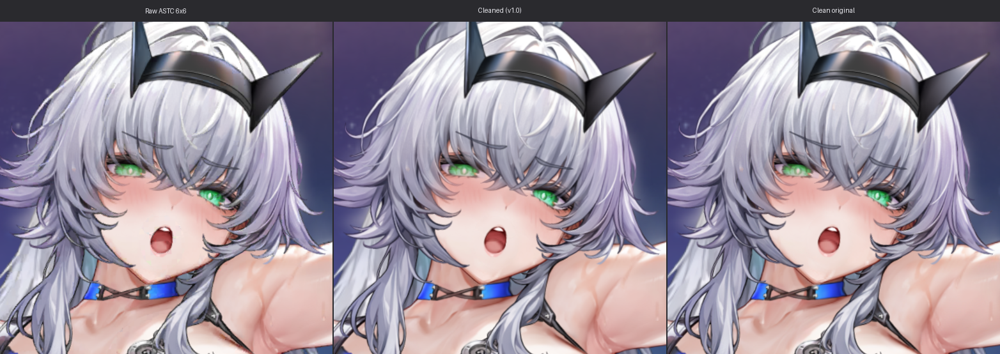
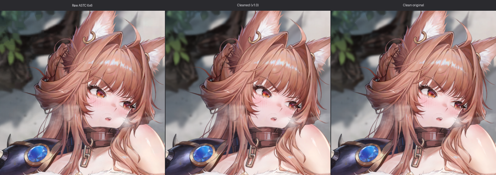
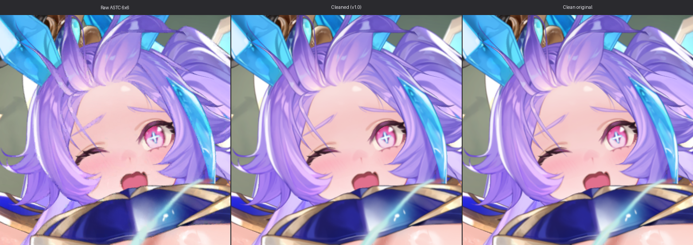
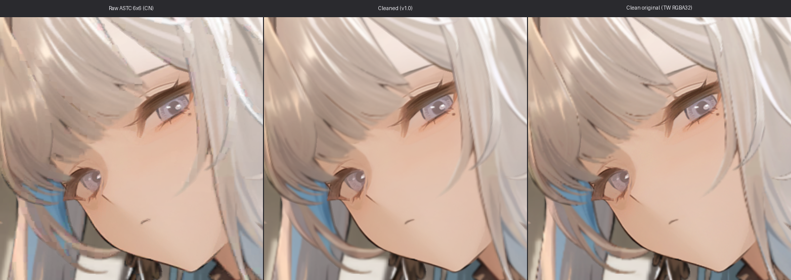

# Daibloscore Texture Cleaner

Removes DXT5 (PC) and ASTC 6x6 (Android) compression damage from the Spine character textures of *Daibloscore* (交错战线): the 4x4/6x6 block noise, colour banding, fringes on soft edges, and most of the seam lines where skin pieces overlap.

The game ships its Spine textures as DXT5 on PC and ASTC 6x6 on Android. Because the two formats divide the image on incompatible block grids (4x4 vs 6x6) and fail in different ways, fusing both copies recovers far more detail than cleaning either one alone. This project identified both exact encoders the game's build uses, so the models are trained on the real damage and not on an approximation of it.

| Mean across 7 held-out real game textures (with known clean originals) | PSNR | Soft edges | Seam error | SSIM |
|---|---|---|---|---|
| Raw PC DXT5 | 38.79 dB | 34.99 dB | 1.152 | 0.8868 |
| Raw Android ASTC 6x6 | 41.34 dB | 37.07 dB | 1.223 | 0.9628 |
| Stage 1, single pass (`--no-refiner --no-ensemble`) | 48.54 dB | 45.29 dB | 0.442 | 0.9924 |
| Fast pipeline (`--no-ensemble`, 3 passes) | 48.76 dB | 45.53 dB | 0.415 | 0.9926 |
| Stage 1, 4x self-ensemble (`--no-refiner`) | 48.81 dB | 45.61 dB | 0.428 | 0.9930 |
| **Full pipeline (default, 6 passes)** | **49.02 dB** | **45.83 dB** | **0.404** | **0.9932** |

Seam error is the render error when a piece is drawn over its own skin colour, counting only line-like error, in 8-bit levels; a clean original scores 0. Seams get much fainter. They do not all disappear: very small pieces (a mouth patch a few blocks wide) lose their edge colour at compression time and no model can know what it was.

## Before and after

The characters as they are drawn in the game (Spine 4.2 render of the idle pose, face area).

### Held-out eval skins (Raw ASTC 6x6 vs Cleaned vs Clean original)

These three textures are held out from training and have known lossless originals from the game build. Left uses the Android ASTC 6x6 texture as shipped, middle uses the paired PC + Android textures run through `clean.py` at the default settings, and right is the clean original.

**Machairodus (`30180_skin_Machairodus04`, `-thorough`)** — Raw ASTC `39.67 dB / seam 1.135` → Cleaned `45.91 dB / seam 0.443`



**Uluru (`10340_skin_Uluru03b`, `-medium`)** — Raw ASTC `41.03 dB / seam 1.223` → Cleaned `48.98 dB / seam 0.397`



**Ijen SP (`60350_skin_IjenSP04a`, `-medium`)** — Raw ASTC `40.62 dB / seam 1.232` → Cleaned `48.68 dB / seam 0.378`



### Live skin (`Kunlun SP`) vs lossless TW `RGBA32`

**Kunlun SP (`30500_skin_KunlunSP04a`)** — left is the shipped CN Android ASTC 6x6 texture (`scale:0.50`), middle is the paired CN PC DXT5 + Android ASTC 6x6 output cleaned with `clean.py` at default settings, and right is the lossless `RGBA32` original shipped in the TW PC build (`scale:0.55`).



> **An unexpected quirk on the left hair lock:** look closely at the diagonal edge of the left hair strand in the middle (`Cleaned (v1.0)`) vs right (`Clean original (TW RGBA32)`) panels. The artist's own lossless `RGBA32` export has a 1-pixel dark Photoshop cutout fringe along that hair piece. Once `DXT5` and `ASTC 6x6` compress that edge, the cutout fringe becomes indistinguishable from compression-induced edge fringing; because the model is trained on clean art with coherent seam loss, it reconstructs a smooth, fringe-free hair edge — inadvertently cleaning up the artist's cutout defect too. Everywhere else (eyelashes, fine painted strands, and highlights), the lossless TW `RGBA32` original remains sharper (`scale:0.55` vs CN's `scale:0.50`).

## What is in here

- `clean.py`: clean paired PC (DXT5) + Android (ASTC 6x6) Unity bundles or decoded PNGs into clean premultiplied-alpha PNGs.
- `evaluate.py`: score the cleaner on a real triple (PC DXT5 + Android ASTC 6x6 + clean original).
- `train_stage1.py`, `train_refiner.py`: train or fine-tune the two models on your own clean art (supports GPU and TPU/XLA).
- `setup_encoders.sh`: downloads ARM `astcenc` 3.5 and compiles the exact Intel ISPC + `stb_dxt` PC DXT5 encoders locally.
- `dclean/`: the library the scripts use (`bundle.py`, `codec.py`, `dxt5.py`, `models.py`, `pipeline.py`, `metrics.py`, `data.py`).
- `native/`: minimal C++ wrappers for the ISPC BC3 kernel and `stb_dxt`.

Not in here: any game art beyond the four small comparison pictures above, the model weights (attached on the Releases page), and the third-party encoder binaries (`setup_encoders.sh` downloads and builds them on your machine).

## Setup

Linux with Python 3.10 or newer (on Windows use WSL). An NVIDIA or AMD GPU is strongly recommended: peak VRAM is about 3.5 GB on a 4096x4096 texture, and cleaning one 4096x4096 texture takes about 118 seconds at default settings (or 56 seconds with `--no-ensemble`, measured on a Radeon RX 9060 XT; a 2048x1024 texture takes about 19 seconds default / 9 seconds with `--no-ensemble`).

```bash
git clone https://github.com/oedon81/Daibloscore-Texture-Cleaner
cd Daibloscore-Texture-Cleaner
```

1. Install PyTorch for your GPU from <https://pytorch.org> (CUDA for NVIDIA, ROCm for AMD).
2. Install the Python dependencies:

```bash
pip install -r requirements.txt
```

3. Download `daiblos_stage1.pt` and `daiblos_refiner.pt` from the
   [Releases page](https://github.com/oedon81/Daibloscore-Texture-Cleaner/releases) into the `models/` folder.
4. Set up the exact game encoders (needed for Stage 2 refinement and for training). Needs `git`, `curl`, and a C++ compiler (if you have no system compiler, `pip install ziglang` provides one and the script will use it automatically):

```bash
./setup_encoders.sh
```

If you skip step 4 you can still clean with `--no-refiner`.

## Cleaning textures

Pass the matching PC (DXT5) and Android (ASTC 6x6) Unity AssetBundles (or decoded RGBA PNGs, or two matching folders):

```bash
python clean.py --pc path/to/pc_bundle.ab --android path/to/android_bundle.ab -o cleaned/skin --copy-others
```

- `--pc` and `--android` can be single files (`.ab` Unity bundles or `.png`) or folders matched by relative path.
- Output files are clean PNGs with premultiplied alpha (`pma:true`), matching what Spine 4.2 expects.
- `--copy-others` extracts the Spine `.atlas` and `.json` files from the PC bundle (or copies non-PNG sidecars from a folder) so the output folder is a ready-to-load Spine 4.2 model.
- Re-running skips textures that already exist in `-o` unless `--overwrite` is passed.

| Option | Effect |
|---|---|
| `--no-ensemble` | Shortcut for `--tta 1 --refiner-tta 1` (3 total passes instead of 6): ~56 s instead of ~118 s per 4096x4096 texture, 0.26 dB lower (`48.76 dB` / seam `0.415`) |
| `--tta {1,2,4,8}` | Number of D4 flips/rotations in Stage 1 (default `4`) |
| `--refiner-tta {1,2,4,8}` | Number of D4 flips/rotations per Stage 2 pass (default `1`) |
| `--max-quality` | Shortcut for `--tta 8 --refiner-tta 8` (24 total passes): ~255 s per 4096x4096 texture, ~0.04 dB higher |
| `--refiner-passes N` | Stage 2 re-encode iterations (default `2`, linear `1/3 + 2/3` blend). `1` is slightly faster and 0.05 dB lower (`48.97 dB` / seam `0.408`) |
| `--no-refiner` | Skip Stage 2: no encoder binaries needed, ~84 s (`4x`) or ~21 s (`1x`), ~0.21 dB lower (`48.81 dB` / seam `0.428`) |
| `--preset {medium,thorough}` | Override the ASTC 6x6 preset (default auto-detects per texture in < 1 s) |
| `--tile N` | Tile size, multiple of 12 (default `768` on GPU, keeps peak VRAM around 3.5 GB) |
| `--compile` | Enable `torch.compile` on GPU (faster for large batches after warmup) |
| `--fp32` | Full precision on GPU (slower, same scores as the default `fp16`) |
| `--cpu` | Run without a GPU |

## Checking a result

If you have a clean original alongside the PC DXT5 and Android ASTC 6x6 files, you can score all stages directly:

```bash
python evaluate.py --pc pc_dxt5.png --android android_astc.png --clean clean_original.png
```

Inputs can be decoded RGBA PNGs or Unity AssetBundles.

## Training

Training needs clean, uncompressed RGBA art. The scripts compress patches on the fly with both exact game encoders, so clean images are all you provide.

Train or fine-tune Stage 1:

```bash
python train_stage1.py --name my_stage1 \
    --data path/to/clean_art:1.0 \
    --init models/daiblos_stage1.pt \
    --val-json path/to/val/real.json
```

Then train or fine-tune the 28-channel Stage 2 Refiner on top of it:

```bash
python train_refiner.py --name my_refiner \
    --stage1 runs/my_stage1/ckpt_best.pt \
    --data path/to/clean_art:1.0 \
    --init models/daiblos_refiner.pt \
    --val-json path/to/val/real.json
```

Use your checkpoints with `python clean.py ... --stage1 runs/my_stage1/ckpt_best.pt --refiner runs/my_refiner/ckpt_best.pt`.

## How it works

1. **Exact game encoders.**
   - **Android ASTC 6x6:** ARM `astcenc` **3.5** in `-cl 6x6 -medium` (most textures) or `-cl 6x6 -thorough`, bottom-up Unity row order, matching **99.92%–99.98%** of blocks byte for byte on held-out real Android bundles.
   - **PC DXT5 (BC3):** Intel ISPC Texture Compressor BC1/BC3 kernel compiled with SSE2 precise math (`--target=sse2-i32x4 --opt=disable-fma`), with collapsed single-colour RGB endpoints (`p0 == p1`) replaced by `stb_dxt` optimal single-colour encoding of the truncated integer block mean — matching **99.11%–99.37%** of whole blocks (**100%** of alpha blocks, 65–66 dB) on held-out real PC bundles.
2. **Stage 1** (`daiblos_stage1.pt`, 43.0M parameters, 384 channels x 16 RCAB blocks with 25x25 Local Channel Attention). Takes 15 channels: premultiplied PC DXT5, premultiplied Android ASTC 6x6, DXT5 alpha-range bounds + solid-block flag, and bottom-up periodic block-phase coordinates `(x%4, y%4, x%6, y%6)` for both block grids. Local Channel Attention lets hair strands (where DXT5 is sharper) and smooth skin/soft rims (where ASTC is cleaner) receive different channel gates without the sparsity shift of global pooling on Spine atlases. Predicts an alpha-coupled residual over the ASTC base in `fp32` so sub-level edge transitions stay clean.
3. **Phase-aligned self-ensemble.** Images are padded to a multiple of `LCM(4, 6) = 12` before rotation/flipping, with periodic `(x%4, y%4, x%6, y%6)` recomputed across the padded tile canvas so borders never see out-of-distribution zero-padded coordinates. Default uses 4 rotations in Stage 1 and 1 pass per Refiner iteration (6 passes total), capturing 99.6% of full 24-pass quality at ~3x the speed.
4. **Stage 2 Refiner** (`daiblos_refiner.pt`, 12.2M parameters, 256 channels x 10 LocalCA RCAB blocks, 28 input channels). Auto-detects `-medium` vs `-thorough` on a single 768x768 crop (< 1 s), re-encodes the Stage 1 prediction with both exact game encoders, and feeds back the signed DXT5/ASTC residuals plus 4 split block-mismatch masks (DXT5 RGB, DXT5 alpha, ASTC RGB, ASTC alpha). Trained with unrolled Pass-2 rollouts so two passes converge cleanly, blended `(1/3, 2/3)` before final 8-bit rounding.

## Versions

| Version | Mean across 7 held-out real textures | Notes |
|---|---|---|
| v1.0 | 49.02 dB / edges 45.83 dB / seam 0.404 / SSIM 0.9932 | Initial release: exact ARM `astcenc 3.5` + ISPC SSE2/`stb_dxt` encoders, 43.0M LocalCA Stage 1, 12.2M 28-ch unrolled Pass-2 Refiner, low-VRAM streaming tile pipeline |

## Credits

- ASTC 6x6 encoder: [ARM astc-encoder 3.5](https://github.com/ARM-software/astc-encoder) (Apache-2.0), downloaded by `setup_encoders.sh`.
- BC3/DXT5 encoder: [Intel ISPC Texture Compressor](https://github.com/GameTechDev/ISPCTextureCompressor) (MIT) and [stb_dxt](https://github.com/nothings/stb) (MIT / Public Domain), built by `setup_encoders.sh`.
- Block decoding & Unity bundles: [texture2ddecoder](https://github.com/K0lb3/texture2ddecoder), [astc-encoder-py](https://github.com/K0lb3/astc-encoder-py), and [UnityPy](https://github.com/K0lb3/UnityPy).

## Licence

- **Code:** MIT, see [LICENSE](LICENSE).
- **Model files** (`daiblos_stage1.pt` and `daiblos_refiner.pt` on the Releases page): not covered by the MIT licence. They are provided as-is for personal, non-commercial use.

This is a fan project and is not affiliated with the game's developer or publisher. No game assets are included apart from the four small comparison pictures in this README, which belong to the game's publisher.
